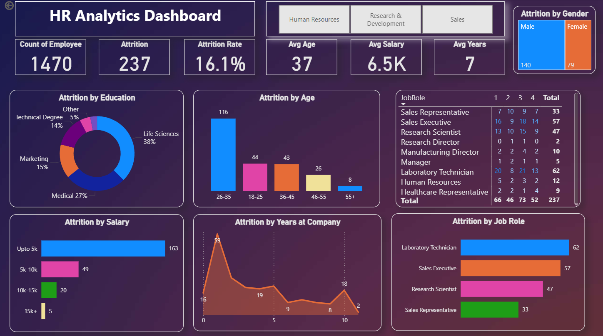

# 📊 HR Analytics & Employee Attrition Intelligence

An end-to-end HR Analytics project designed to investigate employee turnover patterns, evaluate organizational factors, and identify key drivers behind employee attrition. This project demonstrates dual-tool proficiency, utilizing both **Microsoft Excel** and **Power BI** to process, model, and visualize workforce metrics.

---

## 🚀 Project Overview
Employee retention is a critical challenge for modern organizations. This project analyzes a comprehensive dataset of **1,470 employee records** to uncover actionable insights into why employees leave the company, highlighting a total attrition rate of **16.1%**.

---

## 🛠️ Tools & Technologies Used
* **Microsoft Excel:** Data profiling, Pivot Tables, Pivot Charts, and an interactive executive dashboard.
* **Power BI:** Advanced data modeling, DAX measures, Power Query (ETL), and a custom Dark Theme dashboard design.

---

## 📈 Key Analytical Findings & Insights
1. **Attrition Rate:** The overall organizational attrition rate stands at **16.1%** (237 out of 1,470 employees)[cite: 8].
2. **Salary Impact:** Employees earning lower salary brackets (**Upto 5k**) account for the highest volume of departures (**163 employees**), indicating a strong correlation between compensation and retention[cite: 8].
3. **Age & Experience Demographics:** The age group **26-35 years** exhibits the highest turnover (**116 employees**), particularly among roles with fewer years of tenure at the company[cite: 8].
4. **Job Roles:** High-demand operational roles such as *Laboratory Technicians* and *Sales Executives* experience significant movement[cite: 8].

---

## 🖼️ Dashboards & Visualizations

### 1. Power BI Executive Dashboard (Dark Theme)
Designed with a sleek dark aesthetic and structured layout to provide decision-makers with clear, interactive KPIs.

### 2. Excel Analytical Dashboard
Built using advanced Excel reporting techniques, Pivot Tables, and dynamic charts to summarize workforce metrics.

---

## 📂 Repository Structure
* `HR_Analytics.csv` / `HR_Analytics.xlsx`: Raw employee dataset and Excel-based analysis model[cite: 8].
* `HR_Analytics Dashboard.pbix`: The complete Power BI interactive dashboard file.
* `HR_Analytics.png`: High-resolution preview image of the Power BI dashboard[cite: 8].

---
*Created with passion by Lamiaa Mohamed* ✨
